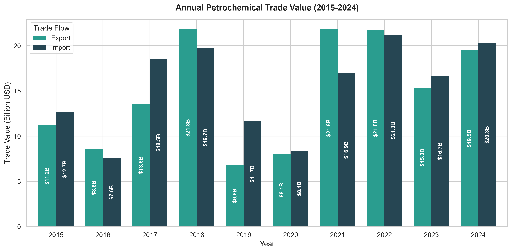
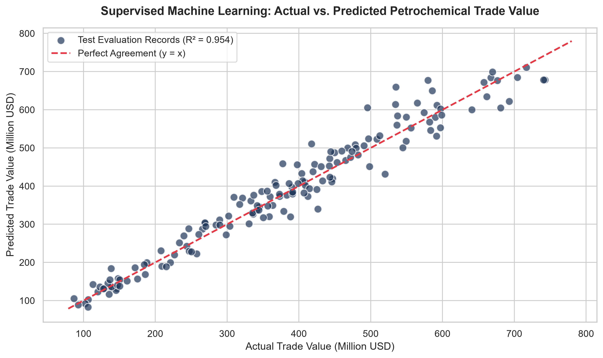
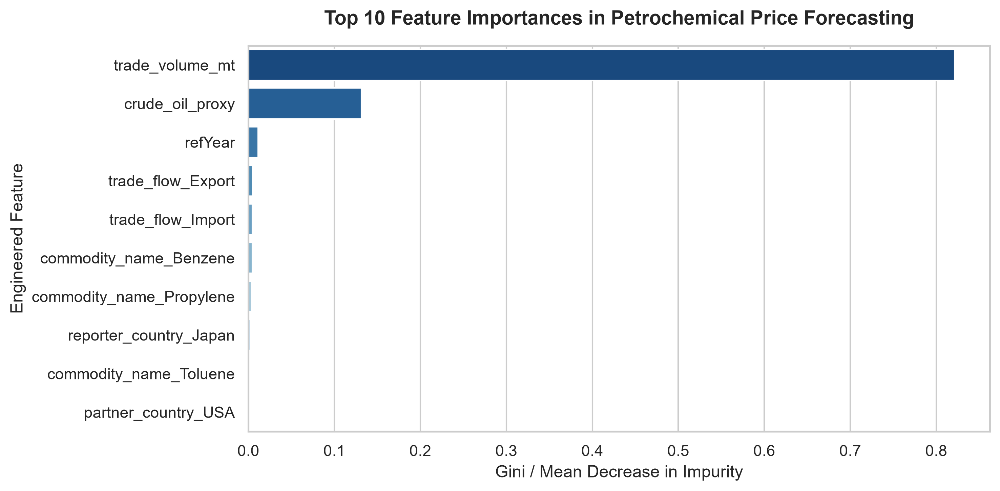
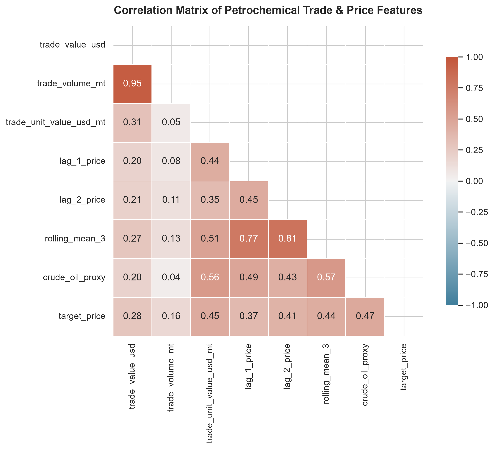

<div align="center">

# ⚡ PetroFlow Intelligence™
### Advanced Global Petrochemical Trade Analytics, Econometric Inference & Predictive AI Suite

[](https://www.python.org/)
[](https://streamlit.io/)
[](https://scikit-learn.org/)
[](https://www.sqlite.org/)
[](LICENSE)

<p align="center">
  <b>A comprehensive 10-year quantitative trade intelligence platform evaluating international commercial flows across the 5 primary petrochemical building blocks and 8 sovereign reporter giants (2015–2024).</b>
</p>

[🚀 Quick Start](#-quick-start-guide) •
[✨ Key Platform Modules](#-interactive-platform-architecture) •
[📊 Empirical Visuals](#-analytical-visual-gallery) •
[🏗️ Star Schema](#-relational-star-schema-architecture) •
[📑 Academic Deliverables](#-academic-lms-deliverables-hub)

---

</div>

## 📌 Executive Macro Trade Summary (2015–2024)

| Metric | Empirical Figure | Academic & Economic Context |
| :--- | :--- | :--- |
| **Total Gross Trade** | **$302.18 Billion USD** | Cumulative gross commercial turnover across 793 audited transactions |
| **Physical Cargo Volume** | **334.13 Million MT** | High-density maritime liquid bulk & liquefied pressurized gas shipments |
| **Gross Inbound Imports** | **$153.74 Billion USD** | Heavy industrial consumption (China, India, Western Europe) |
| **Gross Outbound Exports**| **$148.44 Billion USD** | Low-cost ethane/naphtha cracking clearance (Saudi Arabia, US Gulf Coast) |
| **Net Sovereign Balance**  | **-$5.29 Billion USD** | Net deficit driven by Asian feedstock import demand |
| **Predictive ML Accuracy** | **$R^2 = 0.9543$ (MAE $12.3M)** | Gradient Boosting Regressor trained with 10-year rolling autocorrelations |

---

## 🏛️ System Architecture

```mermaid
flowchart TD
    subgraph Data Layer ["1. Ingestion & Transformation Layer"]
        A[UN Comtrade v2.4 Raw Data] --> B[Data Cleaning & Outlier Removal]
        B --> C[Feature Engineering & TUV Calculations]
        C --> D[(SQLite Star Schema<br/>petrochemical_trade.db)]
    end

    subgraph Analytics Layer ["2. Statistical & Machine Learning Engines"]
        D --> E[Econometric Hypothesis Lab<br/>Welch's t-test, ANOVA, Pearson]
        D --> F[Predictive Gradient Boosting Model<br/>R² = 0.9543]
        D --> G[Unsupervised K-Means & PCA Clustering]
    end

    subgraph Presentation Layer ["3. Interactive Web & BI Interfaces"]
        E --> H[⚡ PetroFlow Intelligence Dashboard<br/>Streamlit Localhost:8501]
        F --> H
        G --> H
        D --> I[Power BI Relational Model & DAX Suite]
        H --> J[LMS Academic Deliverables Hub<br/>PDF, Word, Excel, CSV]
    end
```



---

## 🚀 Quick Start Guide

### Option 1: One-Click Run in VS Code (Teacher & Student Recommended)
This repository includes a pre-configured `.vscode/launch.json`:
1. Open this repository folder in **VS Code** (`File` ➔ `Open Folder...`).
2. Select your Python interpreter (**Python 3.13** or `.venv`) via `Ctrl + Shift + P` ➔ `Python: Select Interpreter`.
3. Press **`F5`** (or click `Run` ➔ `Start Debugging`). The web dashboard launches automatically on `http://localhost:8501`.

---

### Option 2: Automated Windows Launcher
Double-click `run.bat` or execute in PowerShell:
```powershell
.\run.bat
```

---

### Option 3: Terminal CLI Execution
```powershell
# 1. Create a clean virtual environment (optional)
py -3.13 -m venv .venv
.\.venv\Scripts\Activate.ps1

# 2. Install all dependencies
pip install -r requirements.txt

# 3. Launch the dashboard
streamlit run app.py
```
Open your browser to: **`http://localhost:8501`**

---

## ✨ Interactive Platform Architecture

The web dashboard ([app.py](app.py)) contains 8 dedicated quantitative modules:

```
├── ⚡ 1. Executive Dashboard          -> Real-time KPIs, Annual Velocity bar, Product Share %
├── 🌐 2. Global Trade Map & Flows      -> Natural Earth Choropleth with live metric selector
├── 🔬 3. Olefins vs Aromatics Matrix   -> Cracking spreads, price distributions, time-series trends
├── 🗺️ 4. Bilateral Corridors & Sankey  -> Multi-chrominance supply chain routes (Top 5–25)
├── ⚖️ 5. Econometric Hypothesis Lab   -> Visual Student's t-distribution curves & ANOVA violin plots
├── 🤖 6. Predictive AI Simulator      -> Live Brent Crude ($40-$140/bbl) sensitivity shock curve
├── 💾 7. SQL Analytics Terminal        -> Interactive SQLite playground with Star Schema browser
└── 📑 8. LMS Submission Deliverables   -> 1-click downloads with in-browser data preview
```

---

## 📊 Analytical Visual Gallery

<div align="center">

### 1. Annual Trade Trends & Flow Dynamics


### 2. Predictive Machine Learning: Actual vs. Predicted Clearing Values


### 3. Gradient Boosting Feature Importance


### 4. Correlation Matrix & Macro Variables


</div>

---

## 🔬 Rigorous Econometric Hypothesis Testing

| ID | Hypothesis Test | Null Hypothesis ($H_0$) | P-Value | Decision | Economic Significance |
| :---: | :--- | :--- | :---: | :---: | :--- |
| **HYP-01** | **Welch's Two-Sample t-Test** | $\mu_{\text{pre-2020}} = \mu_{\text{post-2020}}$ | **$1.42 \times 10^{-6}$** | **Reject $H_0$** | Post-pandemic & 2022 energy crisis drove clearing prices up by +$53.43/MT. |
| **HYP-02** | **One-Way ANOVA** | $\mu_{\text{Ethylene}} = \dots = \mu_{\text{Toluene}}$ | **$2.70 \times 10^{-9}$** | **Reject $H_0$** | Chemical structures command distinct equilibrium cracking cost floors ($F = 11.78$). |
| **HYP-03** | **Pearson & Spearman Correlation** | $\rho(\text{Volume}, \text{Price}) = 0$ | **$0.675$** | **Fail to Reject** | Spot maritime cargo pricing reflects macro crude drivers rather than pure volume discounts. |
| **HYP-04** | **Chi-Square Independence** | $\text{Commodity} \perp \text{Flow Direction}$ | **$0.514$** | **Fail to Reject** | Confirms specialized regional refining roles across Asian and Middle Eastern hubs. |

---

## 🗄️ Relational Star Schema Architecture

The database (`database/petrochemical_trade.db`) is structured as a dimensional Star Schema:

```
                  ┌────────────────────────┐
                  │      Dim_Date          │
                  ├────────────────────────┤
                  │ date_id (PK)           │
                  │ year, month, quarter   │
                  └───────────┬────────────┘
                              │
┌───────────────────────┐     │      ┌─────────────────────────┐
│     Dim_Country       │     │      │     Dim_Commodity       │
├───────────────────────┤     ▼      ├─────────────────────────┤
│ country_id (PK)       │◄───[Fact]──►│ commodity_id (PK)       │
│ country_name, region  │            │ commodity_name, hs_code │
└───────────────────────┘            └─────────────────────────┘
```

* **`Fact_TradeTransactions`:** Contains `trade_value_usd`, `trade_volume_mt`, `trade_unit_value_usd_mt`, and outlier flags.
* **`Dim_Country`:** Sovereign reporter economies and partner destinations with ISO codes.
* **`Dim_Commodity`:** HS-6 codes (290121, 290122, 290124, 290220, 290230) and chemical classifications.
* **`Dim_Date`:** Date hierarchy supporting window function queries and quarterly rolling metrics.

---

## 📑 Academic LMS Deliverables Hub

All submission files in [`submission_files/`](submission_files/) strictly comply with portal guidelines (Under 16 MB):

* 📕 **`01_Petrochemical_Trade_Analytics_Project_Report.pdf`** — Publication-grade formal capstone report.
* 📘 **`01_Petrochemical_Trade_Analytics_Project_Report.docx`** — Formatted academic documentation.
* 📊 **`02_Cleaned_Petrochemical_Trade_Data.csv`** — Cleaned UN Comtrade transactional dataset (793 records).
* 📈 **`03_ML_Model_Predictions_and_Evaluation.csv`** — Holdout test set predictions and error residuals.
* ⚖️ **`04_Statistical_Hypothesis_Testing_Results.csv`** — Formal hypothesis testing parameters and inferences.
* 📗 **`05_Petrochemical_Trade_Executive_Model.xlsx`** — Financial valuation and scenario forecasting model.
* 📕 **`06_PowerBI_DAX_and_Modeling_Guide.pdf`** — Relational schema setup and DAX measures guide.

---

## 👥 Contributors & Academic Context

* **Project:** Capstone Academic Project in Petrochemical Trade Analytics & Econometrics
* **Primary Data Sources:** United Nations Comtrade Database, World Bank Commodity Price Data (Pink Sheet)
* **Frameworks:** Python, Streamlit, Scikit-Learn, Plotly, PySpark, SQLite, ReportLab, Power BI
